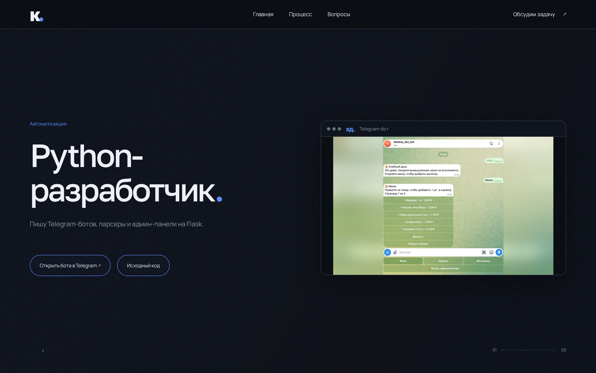
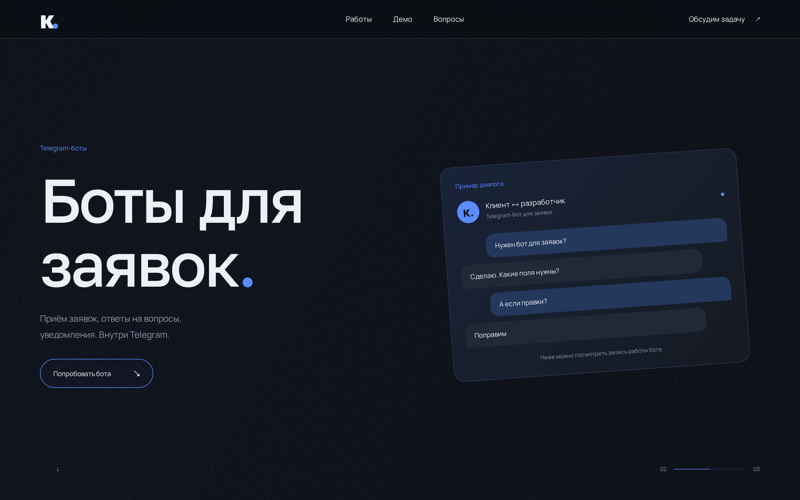
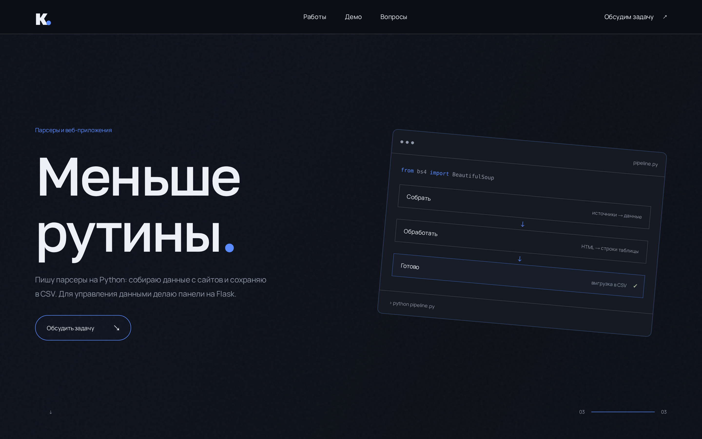
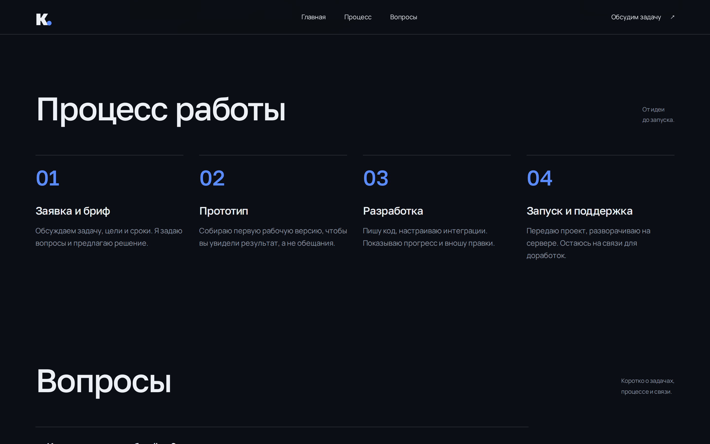
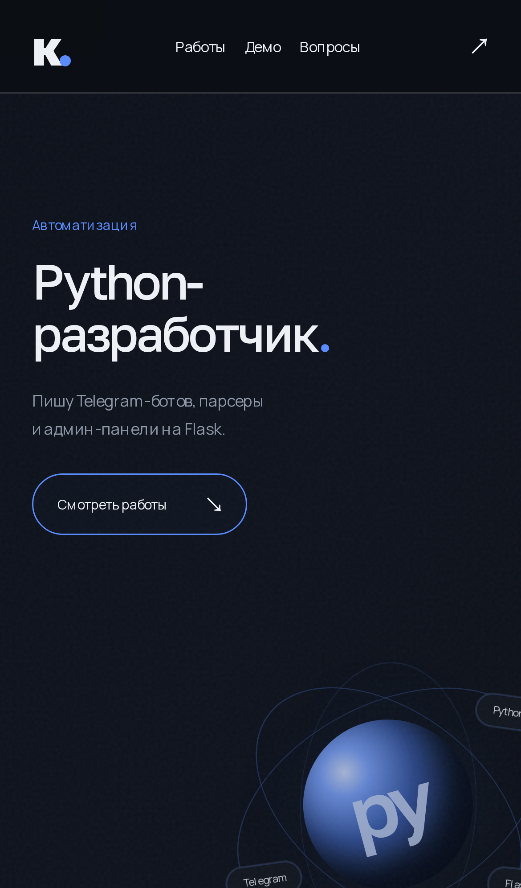
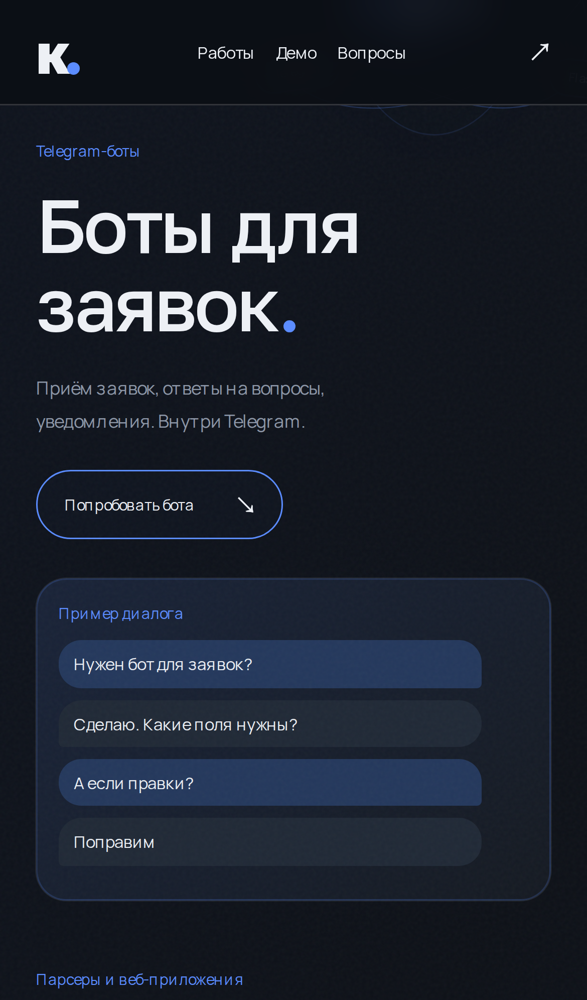
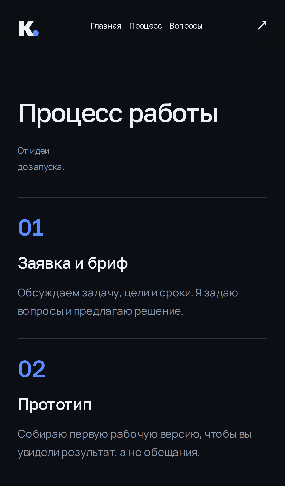

# Портфолио Кирилла

[English version](README.md)

Одностраничный сайт-визитка Python-разработчика. Написан с нуля на чистом HTML, CSS и JavaScript. Без сборщиков, фреймворков и тяжелых зависимостей.

## Демонстрация

**Кадр 1: Главный экран (Python + Telegram-бот)**
Первый экран сразу демонстрирует рабочий продукт. Ниже — сквозное видео: клиент делает заказ в Telegram, и он мгновенно появляется в админ-панели.

https://github.com/user-attachments/assets/2d0d89f3-b961-4acd-ae63-d2c85c68ff36

*Кинематографичная смена трех кадров реализована на нативном `position: sticky` и `requestAnimationFrame`.*


**Кадр 2: Админ-панель заказов**
Второй экран демонстрирует бэкенд-часть экосистемы (Flask + SQLite) в виде окна браузера.


**Кадр 3: Этот сайт-визитка**
Третий экран фокусируется на фронтенд-навыках: чистый HTML, CSS и Vanilla JS с темной темой и адаптивными анимациями.


**Секция «Процесс работы»**
Отдельная секция, объясняющая этапы работы от идеи до запуска, что дает потенциальным клиентам уверенность в процессе разработки.


### Адаптивность (Mobile)
Полная поддержка мобильных устройств. На экранах меньше 900px сложная сетка и кинематографичный скролл перестраиваются в удобную для чтения колонку.

| Главный экран | Админ-панель | Процесс |
| :---: | :---: | :---: |
|  |  |  |

## Технические особенности

*   **Zero Build Step:** Проект запускается открытием `index.html` или через любой статический сервер. Не требует `npm install`.
*   **Vanilla JS:** Вся логика (кинематографичная смена кадров при скролле, магнитные кнопки) написана на чистом JavaScript без тяжелых библиотек.
*   **Accessibility (A11Y):** Поддержка навигации с клавиатуры (Tab, Focus), семантическая верстка, скрытые заголовки для скринридеров.
*   **Performance:** Анимации завязаны только на `transform` и `opacity`. Тяжелые скрипты и изображения загружаются лениво (`loading="lazy"`).
*   **Reduced Motion:** Если у пользователя включено ограничение движения в ОС (`prefers-reduced-motion`), анимации автоматически отключаются, видео ставится на паузу, а контент отображается последовательно в статике.

## Запуск

Нужен Python 3, чтобы запустить локальный сервер:

```sh
python3 -m http.server 8080
