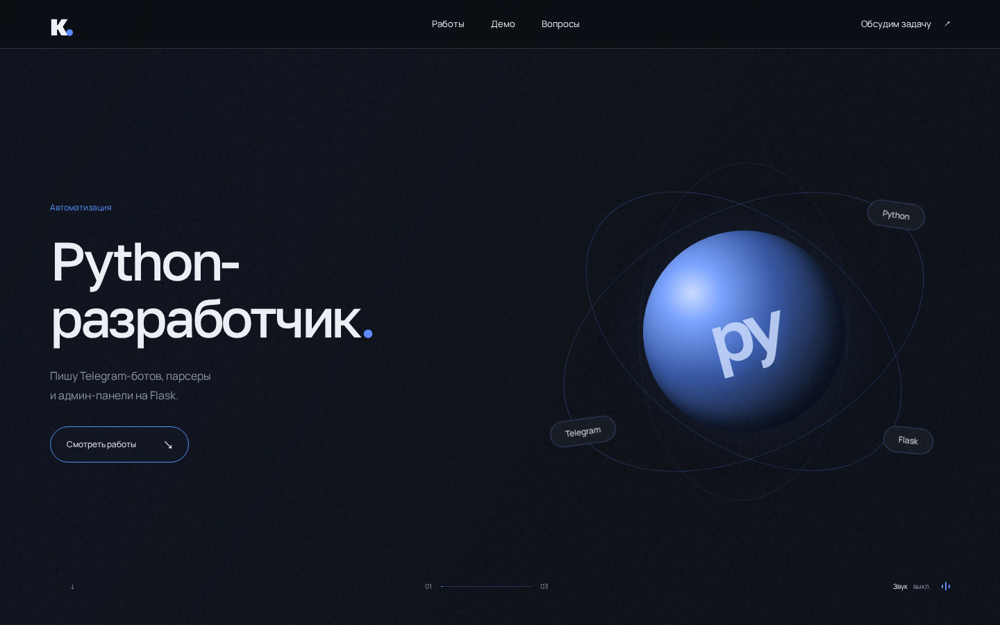
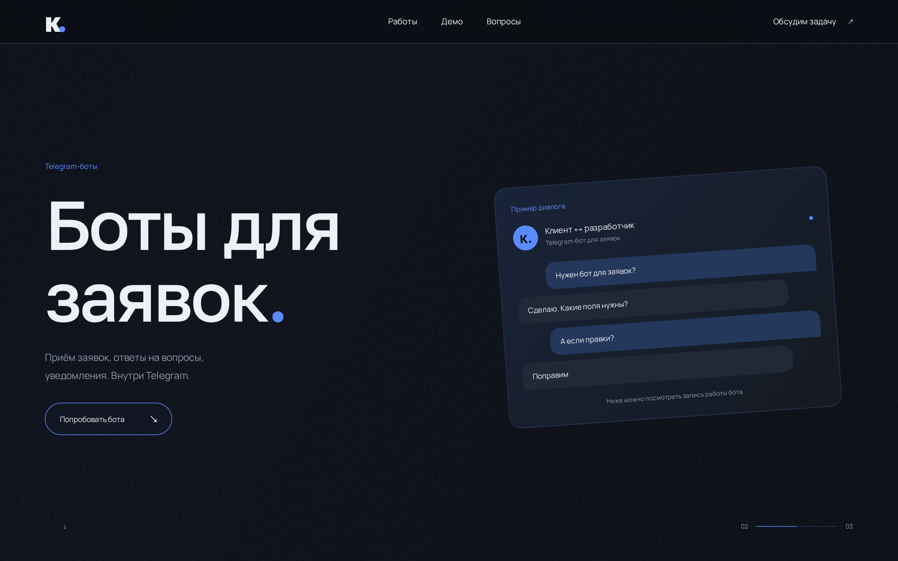
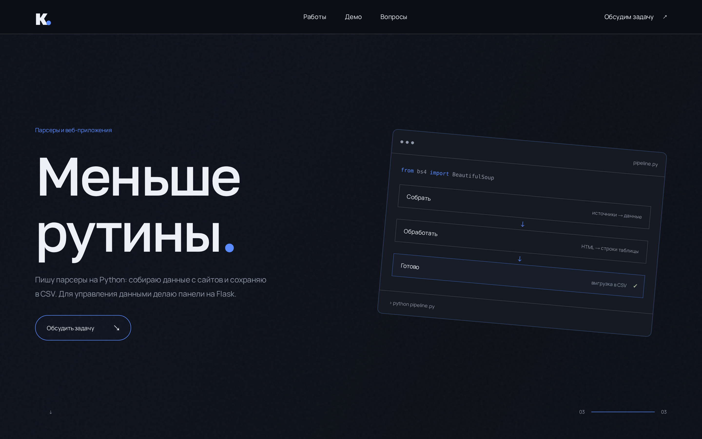
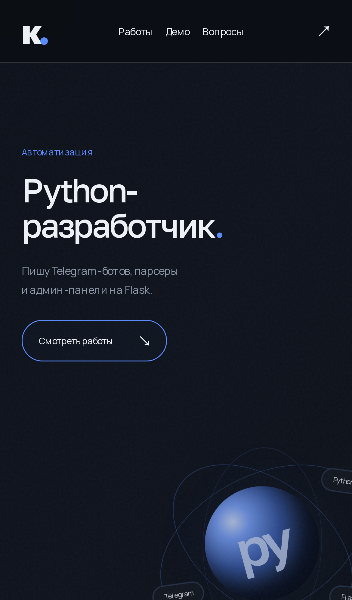
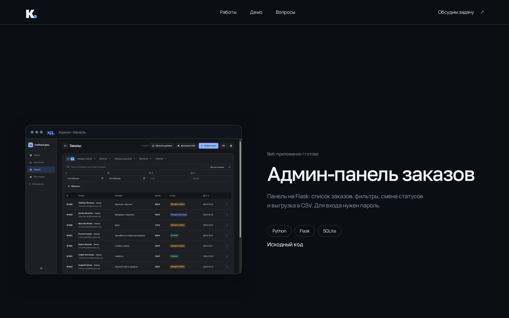

# Сайт-портфолио (Визитка)

Одностраничный сайт-визитка Python-разработчика. Написан с нуля на чистом HTML, CSS и JavaScript. Без сборщиков, фреймворков и тяжелых зависимостей.

## Демонстрация

**Главный экран (Кинематографичный скролл)**
Смена трех кадров с эффектом параллакса реализована на нативном `position: sticky` и `requestAnimationFrame`.


**Кадр 2: Telegram-боты**


**Кадр 3: Парсеры и данные**


**Адаптивность**
Полная поддержка мобильных устройств. На экранах меньше 900px сложная сетка перестраивается в удобную колонку.
| Desktop | Mobile |
| :---: | :---: |
|  |  |

**Секция проектов**
Презентация работ в виде окон браузера (Browser Frame) с чередованием сторон (Z-pattern).


## Технические особенности

*   **Zero Build Step:** Проект запускается открытием `index.html` или через любой статический сервер. Не требует `npm install`.
*   **Vanilla JS:** Вся логика (переключение кадров при скролле, кастомный курсор, магнитные кнопки) написана на чистом JavaScript.
*   **Accessibility (A11Y):** Поддержка навигации с клавиатуры (Tab, Focus), семантическая верстка, скрытые заголовки для скринридеров.
*   **Performance:** Анимации завязаны только на `transform` и `opacity`. Тяжелые скрипты и изображения загружаются лениво (`loading="lazy"`).
*   **Reduced Motion:** Если у пользователя включено ограничение движения в ОС, анимации автоматически отключаются, а контент отображается в статике.

## Запуск

Нужен Python 3:

```sh
python3 serve.py
```

Откройте http://127.0.0.1:8080/. Другой порт: `python3 serve.py --port 8081`. Сервер слушает только `127.0.0.1`; `--bind` позволяет изменить адрес. Это сервер для локального просмотра, не для публикации сайта.

Можно открыть `index.html` без сервера. Для загрузки шрифтов Google Fonts нужна сеть; без неё браузер использует системный шрифт.

## Структура проекта

- `index.html`: тексты, проекты, ссылки и FAQ.
- `styles.css`: оформление и адаптивная вёрстка.
- `main.js`: смена кадров при прокрутке и анимации.
- `assets/demo-bot.mp4`: запись работы бота.
- `assets/projects/`: скриншоты проектов и сайта.
- `serve.py`: локальный сервер.
- `screenshot.py`: обновление `assets/projects/vizitka.png`.
- [DESIGN.md](DESIGN.md): оформление и поведение сайта.

## Как это работает

При прокрутке JavaScript переключает три кадра, обновляет номер и индикатор прогресса. Ссылки с магнитным эффектом смещаются вслед за указателем мыши.

При включённом `prefers-reduced-motion` или на экранах небольшой высоты кадры идут друг за другом. Без JavaScript сохраняется тот же порядок. При `prefers-reduced-motion` видео не запускается автоматически, а магнитный эффект отключается. Анимация фона работает до пяти секунд, пока её видно; на мобильных экранах, при уменьшении движения и в режиме принудительных цветов она отключена.

## Скриншот

Для `screenshot.py` нужны Playwright и Chromium:

```sh
python3 -m venv .venv
.venv/bin/pip install playwright
.venv/bin/playwright install chromium
```

При запущенном сервере на порту 8080 выполните:

```sh
.venv/bin/python screenshot.py
```

Команда перезапишет `assets/projects/vizitka.png` снимком первого экрана размером 1440 × 900.

## Проверка изменений

Проверьте три кадра при прокрутке, ссылки проектов, видео и FAQ. Повторите проверку на узком экране и с включённым `prefers-reduced-motion`. Без JavaScript все три кадра должны идти друг за другом.

Автоматических тестов в проекте нет.
